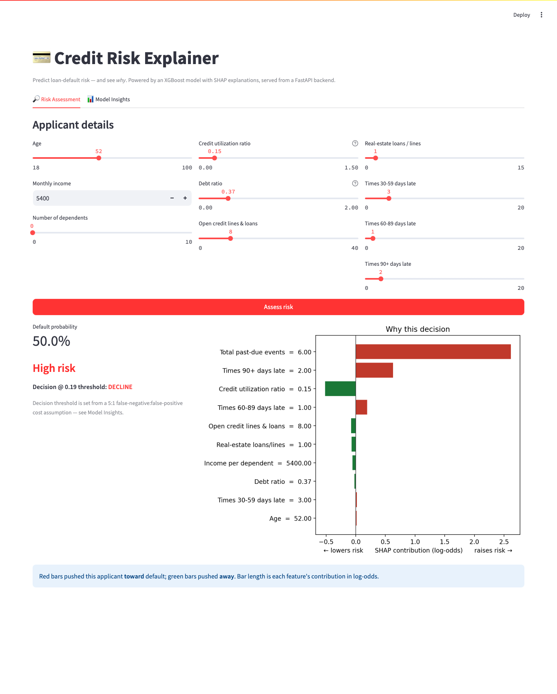
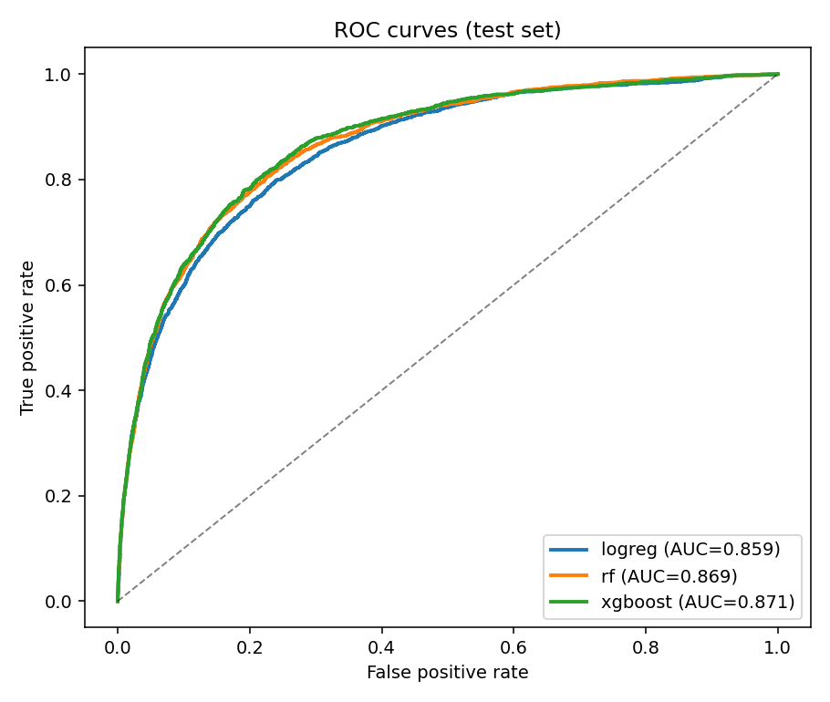
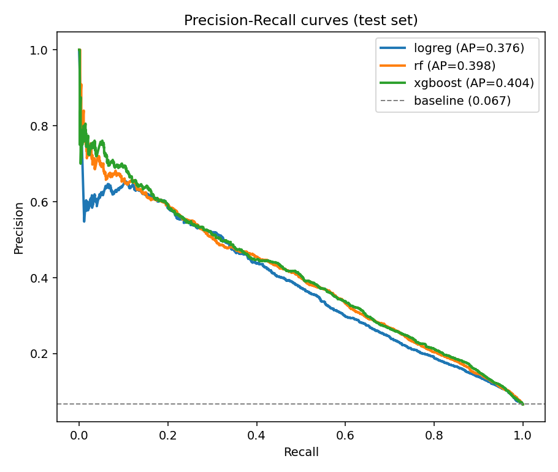
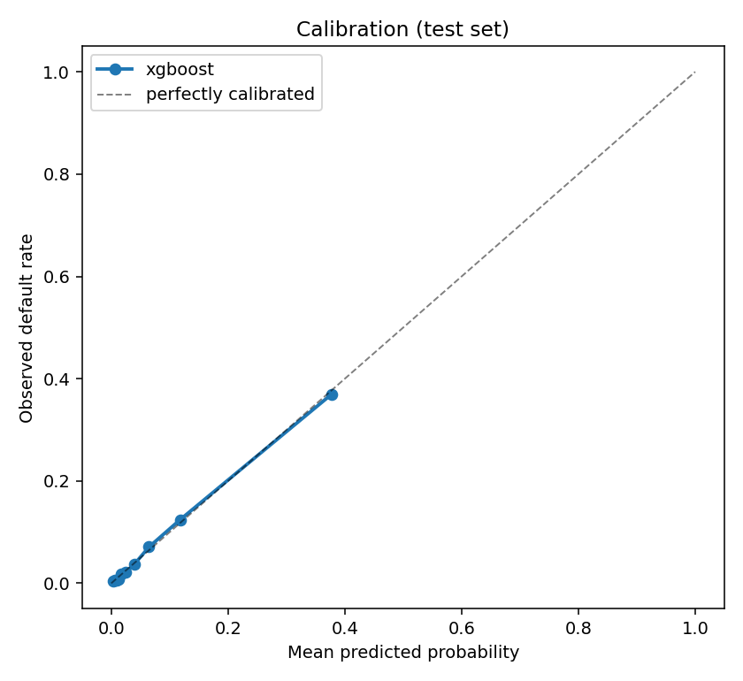
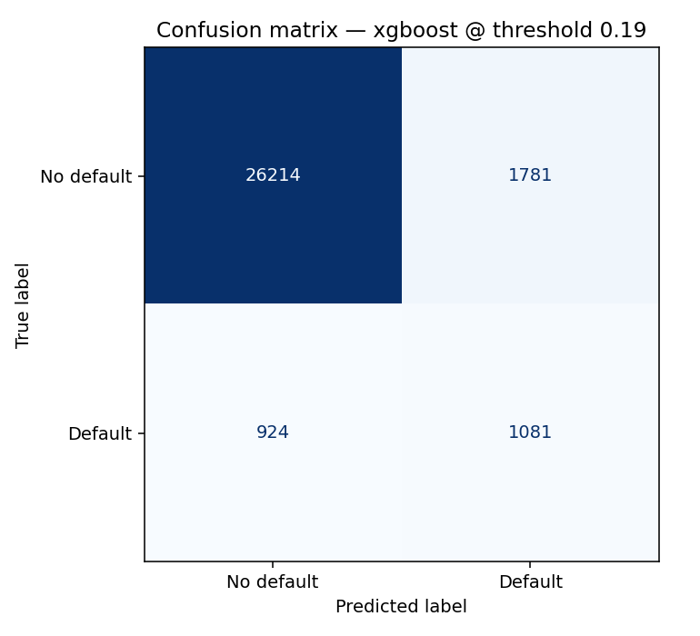
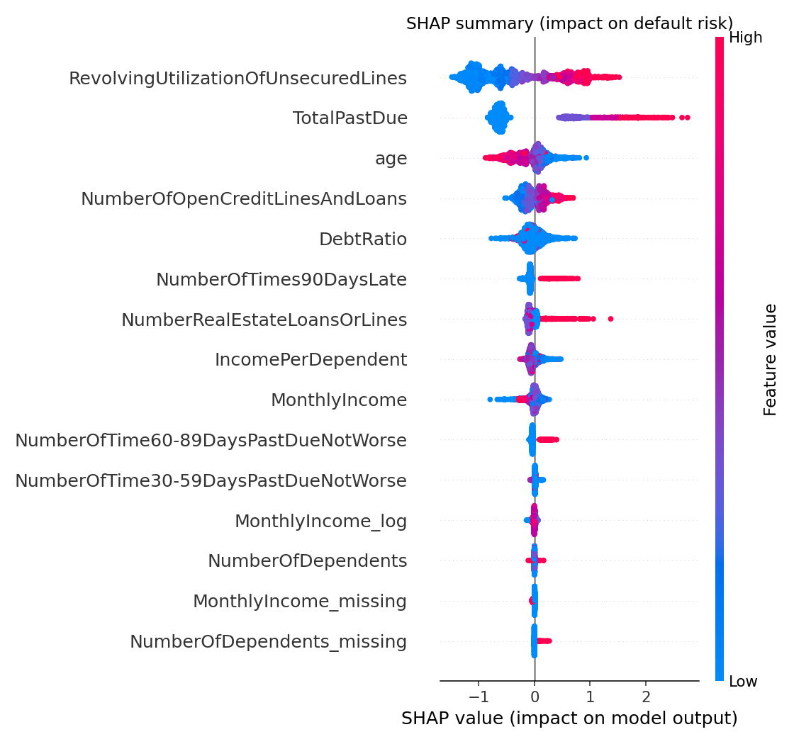
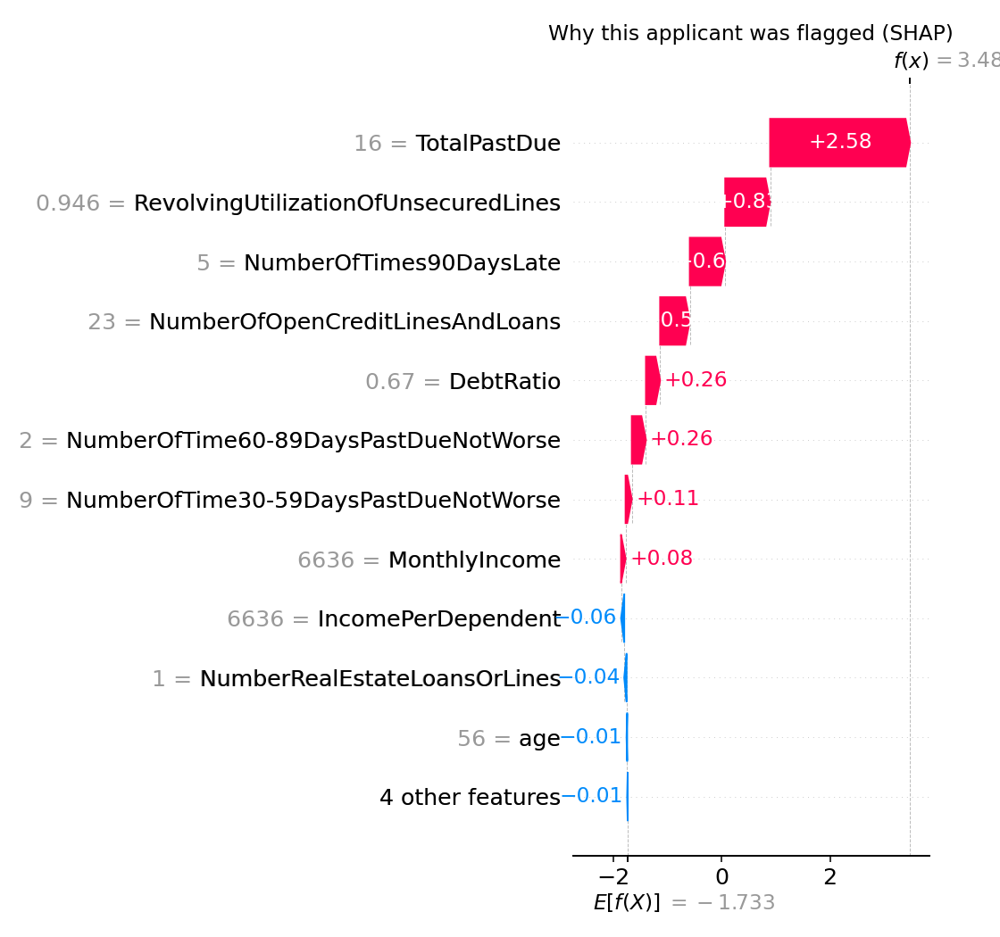
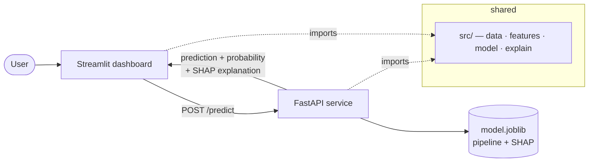
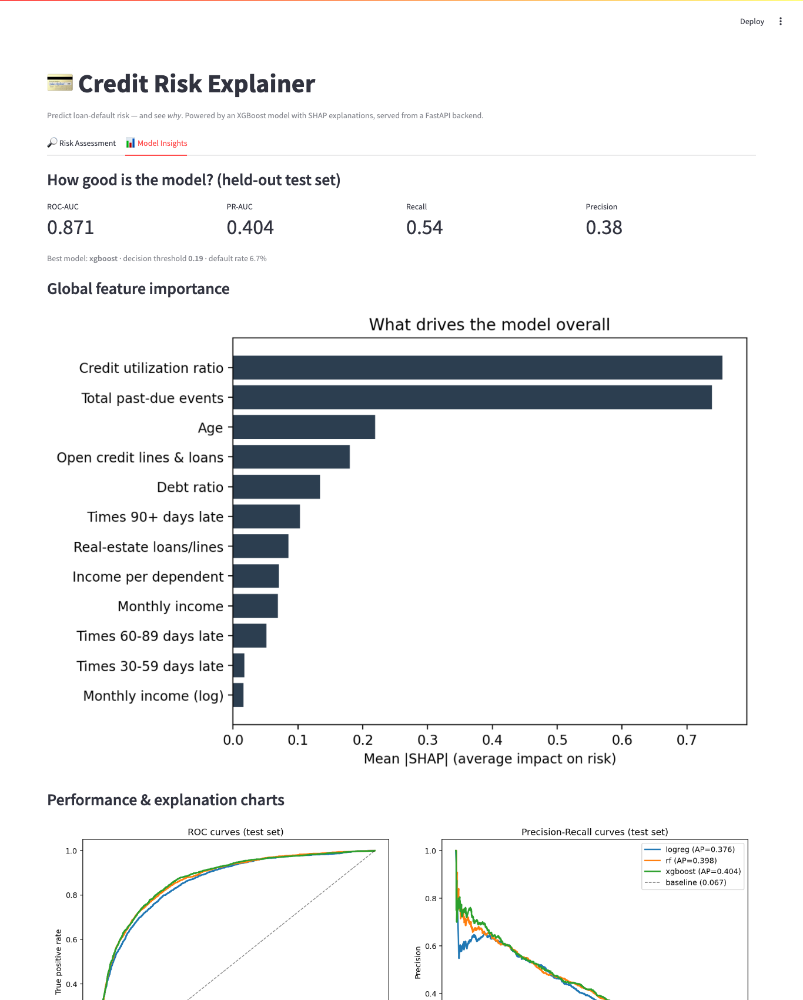

# Credit Risk Explainer

[](https://github.com/shaurya703/credit-risk-explainer/actions/workflows/ci.yml)

An end-to-end machine-learning application that predicts loan-default risk **and
explains every prediction**. The full chain — reproducible data pipeline → trained,
calibrated model → FastAPI service → interactive Streamlit dashboard — with
**explainability (SHAP)** as the headline feature: users see not just a score but
*which features pushed the decision which way*.



---

## Problem

Predict whether a borrower will hit **serious financial distress** (90+ days
delinquent) within two years — the core of a credit-underwriting decision. The hard
parts aren't just accuracy:

- the event is **rare** (~6.7% of applicants), so accuracy is meaningless;
- the two mistakes have **very different costs** (approving a defaulter ≫ rejecting a
  good applicant); and
- a credit decision must be **explainable** to be auditable and trustworthy.

## Dataset

[**Give Me Some Credit**](https://www.kaggle.com/competitions/GiveMeSomeCredit)
(150,000 applicants, 10 features), loaded reproducibly from
[OpenML dataset 46929](https://www.openml.org/d/46929) — no Kaggle credentials
needed. It's genuinely messy: ~20% missing `MonthlyIncome`, heavy-tailed ratios
(`RevolvingUtilization` up to 50,708), an impossible `age = 0`, and a documented
`96/98` data glitch in the past-due columns. All handled and **documented** in
`notebooks/02_preprocessing.ipynb`.

## Modeling approach (and why)

| Choice | What | Why |
|---|---|---|
| **One sklearn Pipeline** | `CreditFeatureBuilder` (impute + cap + engineer) → classifier | identical transform at train and serve; no leakage; no duplicated logic |
| **Three models** | Logistic Regression → Random Forest → **XGBoost** | interpretable baseline up to gradient boosting; compare honestly |
| **Imbalance via calibrated threshold** | XGBoost trained **unweighted**, threshold set by business cost | keeps probabilities **calibrated** for use as a risk score (the `scale_pos_weight` ablation in nb 03 shows reweighting wrecks calibration for negligible ranking gain) |
| **Threshold from a 5:1 cost** | minimize `5·FN + 1·FP` on validation | a missed default costs far more than a wrongly rejected applicant |

Validation comparison (PR-AUC is the metric that matters under imbalance):

| Model | ROC-AUC | PR-AUC |
|---|---|---|
| Logistic Regression | 0.846 | 0.367 |
| Random Forest | 0.855 | 0.383 |
| **XGBoost** ✅ | **0.859** | **0.387** |

## Headline results (held-out test set)

| Metric | Value |
|---|---|
| **ROC-AUC** | **0.871** |
| **PR-AUC** | **0.404** (no-skill baseline = 0.067) |
| **Brier score** | **0.049** (well-calibrated) |
| Recall / Precision @ threshold 0.19 | 0.54 / 0.38 |

<p>


</p>
<p>


</p>

The model is deliberately tuned for **recall** at the chosen threshold — it catches
~54% of true defaulters (1,081 of 2,005 on the test set) at the cost of flagging
1,781 good applicants, reflecting the 5:1 cost assumption. That trade is a *business
dial*, not a fixed accuracy number.

## Explainability — the headline feature

**Global** — what the model relies on overall (credit utilization, total past-due
history, and age dominate):



**Local** — *why this applicant?* Every prediction is decomposed into per-feature
contributions (the API returns this; the dashboard visualizes it):



## The application



- **FastAPI** — `POST /predict` returns prediction, **calibrated probability**, risk
  band, approve/decline decision, and the **per-feature SHAP explanation**; plus
  `GET /health` and `GET /model-info` (metrics + global importance).
- **Streamlit dashboard** — an applicant form that calls the API live and shows the
  SHAP breakdown, plus a global-insights tab. It **never loads the model** — all model
  logic lives behind the API.



## How to run

**With Docker (one command):**
```bash
docker compose up --build
# API       -> http://localhost:8000  (docs at /docs)
# Dashboard -> http://localhost:8501
```

**Locally:**
```bash
python3.12 -m venv .venv && source .venv/bin/activate
pip install -r requirements.txt

python -m src.train          # data -> train -> evaluate -> save model + figures
uvicorn api.main:app --port 8000          # terminal 1
API_URL=http://localhost:8000 streamlit run dashboard/app.py   # terminal 2
```

Reproduce the whole pipeline from scratch with `make pipeline`; run tests with
`make test` (or `pytest`).

## Project structure

```
credit-risk-explainer/
├── data/            raw + processed (download script; raw is git-ignored)
├── notebooks/       01_eda · 02_preprocessing · 03_modeling · 04_evaluation
├── src/             data.py · features.py · model.py · explain.py · train.py · config.py
├── api/             FastAPI service (main.py, schemas.py)
├── dashboard/       Streamlit app (app.py)
├── models/          model.joblib + metrics.json (committed, for reproducible runs)
├── reports/figures/ evaluation + SHAP + dashboard images
├── tests/           features, inference, API
└── Dockerfile · docker-compose.yml · Makefile · requirements*.txt
```

`src/` is the single source of truth, imported by the notebooks, the API, and the
dashboard — no copy-pasted model logic.

## Fairness & limitations (honest)

- **No protected attributes** exist in this data (no race/gender), so direct fairness
  auditing isn't possible here — but income/age can act as **proxies**, and a real
  deployment would require disparate-impact testing on protected groups.
- **This is a portfolio model, not an underwriting system.** It ignores regulatory
  requirements (ECOA/FCRA adverse-action notices), temporal drift, and the
  selective-labels problem (rejected applicants never reveal their true outcome).
- **The 5:1 cost ratio is an assumption**, not a measured loss-vs-margin figure — the
  threshold should be set from real economics.
- Probabilities are well-calibrated (Brier 0.049) but should be **monitored and
  periodically re-calibrated** in production.

## What I'd improve next

- **Fairness tooling** — wire in disparate-impact / equalized-odds checks on a dataset
  that includes protected attributes.
- **Monitoring** — log predictions + feature distributions to detect drift and
  calibration decay; add a scheduled retrain.
- **Richer explanations** — counterfactual "what would flip this decision?" alongside
  SHAP, which is far more actionable for an applicant.
- **Model registry & CI** — track model versions/metrics and gate deploys on an
  evaluation threshold.

## Tech stack

Python 3.12 · pandas · numpy · scikit-learn · XGBoost · SHAP · FastAPI · Streamlit ·
Docker Compose · pytest.
